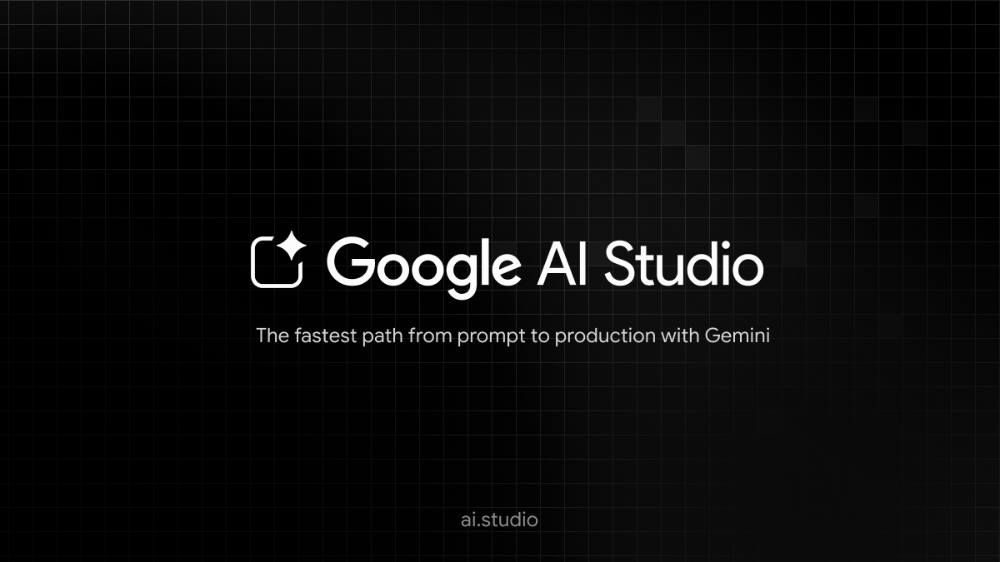
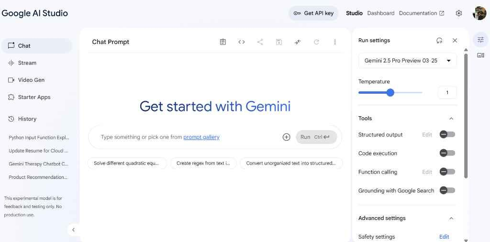
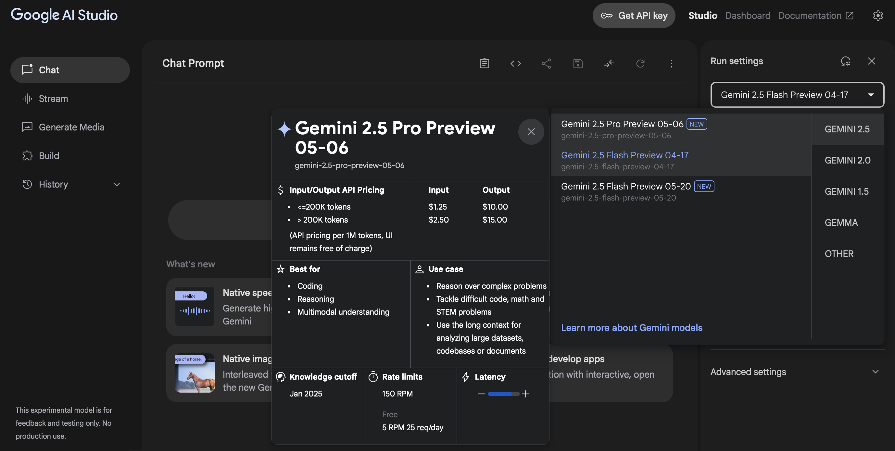

# Gemini Studio AI

Gemini Studio AI is the browser bench for the Gemini family. Google AI Studio is that same bench: you open it in a browser, pick a model, and try a prompt before any of the code leaves your laptop. google gemini ai studio is the name people type when they want that page. gemini ai studio and gemini studio are the shorter forms of the same editor.

The point of the studio is control. You set the model, the temperature, the tools, and the length, then you read the reply in the same window. When the prompt is stable you export it. The companion files in this tree are the client, the model caller, and the settings that sit under that export.

A consumer chat is a different product. Gemini Studio AI keeps the parameters on screen so a developer, a student, or a creator can see why a reply changed.



## What's New?

The current studio pass keeps prompts, files, and tools in one project. A saved prompt remembers the model and the tool switches, so the next session does not start from a blank box. Image and video generators sit next to the text models. Imagen and Veo are the names on those generators. Speech tools sit on the same account.

Context windows go up to about 1 million tokens on the models that advertise that size. That is enough for a long spec, a transcript, or a pile of source files. Confirm the limit on the model card in the studio. A smaller model still has a smaller window.

App building, sometimes called vibe coding, lets you describe a small web app and have the studio draft the front end and the back end in the browser. Treat that draft as a starting repo. Read it before you ship it.

## Navigating the Cookbook

Think of the studio as three rooms. The playground is where a prompt is tried. The key page is where a Gemini API key is created. The export is the code you paste into your own project. You can live in the playground for a day and never open the key page. You open the key page when a script on your machine must call the same model.

[client.py](client.py) is the `Client` class for that export. It takes `api_key` for the Gemini Developer API, or `project` and `location` when you are on Vertex. [models.py](genai/models.py) is the module behind `client.models`, including `generate_content`, `generate_images`, and `generate_videos`. [index.ts](index.ts) is the TypeScript barrel for the settings and services that a local tool uses beside the studio.

## Examples (Practical Use Cases)

A practical session is short. Paste a prompt, attach a file if the model should see it, turn on one tool, and run. Change one knob. Run again. Save the prompt when the two replies are different in a way you can explain.

Good first jobs:

| Job | What you attach | Tool you might enable |
| --- | --- | --- |
| Prompt playground | Text only | None |
| Image generation | A text prompt, sometimes a source image | Imagen |
| Video generation | Text, or a still frame | Veo |
| Speech | Text, or a short clip | Audio model |
| Grounded answer | A question that needs the live web | Google Search |
| Map answer | A place question | Google Maps |
| Code check | A snippet | Code execution |
| Your own API | A function schema | Function calling |

| Path | Who it is for | What you pay attention to |
| --- | --- | --- |
| Browser studio | Trying a prompt, a class, a first demo | Model, temperature, tools, saved prompt |
| API key in your app | A script or a product | Key restrictions, quota, the exported call |
| Vertex project | A Cloud project with its own quota | Project id and location on the client |

The studio does not print a dollar rate on this page. The free entry is the browser trial. API use past that allowance follows the Gemini API price list on Google's site.

## Demos (End-to-End Applications)

A demo in this product is a prompt that survives a second day. Name it. Store the model id next to it. If the demo calls a function, store the schema beside the prompt so a teammate can run the same call.

[chats.py](genai/chats.py) holds the multi-turn chat helper. Use it when the demo is a conversation, not a single completion. [files.py](genai/files.py) uploads a file the model must read. [live.py](genai/live.py) is the live session path for audio that should stream instead of waiting for a full file.

[sample.py](files/sample.py) and [sample.js](files/sample.js) are the file-upload samples, one in Python and one in JavaScript. They show the same idea: send the bytes, then refer to the file in the next content call.

## Official SDKs

Google AI Studio can show the call in more than one language. The Python shape in this tree is `Client` plus `client.models.generate_content`. The JavaScript samples live under `audio` and `tokens`. The TypeScript settings live under `config`.

[package.json](package.json) is the workspace manifest. Its `build` script is `node scripts/build.js`. That script file is not in this file set, so do not expect `npm run build` to finish here. The manifest still tells you the Node engine: 20 or newer. [tsconfig.json](tsconfig.json) is the TypeScript config for that workspace. `pyproject.toml` names the Python package `google-genai`.

```python
client = Client(api_key=api_key)
client.models.generate_content(
    model=model_id,
    contents=prompt,
)
```

`Client` is the class in `client.py`. `model_id` is the id you selected in Gemini Studio AI, copied from the studio, not invented in the script.

## Get Help

When a call fails, read the error before you change the prompt. [errors.py](genai/errors.py) is the error module for the Python client. A key problem and a safety block look different. A missing file reference looks different again.

The studio UI is the fastest place to see whether the model itself refused the prompt. If the same prompt fails in the studio and in your script, the script is not the bug. If the studio succeeds and the script fails, compare the model id, the tool list, and the key.

## The Gemini API on Google Cloud Vertex AI

The same client can talk to the Gemini Developer API or to Vertex. Pass `api_key` for the developer API you created in Google AI Studio. Pass `vertexai` or `enterprise`, plus `project` and `location`, for a Cloud project. The constructor raises `ValueError` if `enterprise` and `vertexai` disagree.

Do not put the key in the repo. The studio lets you create and restrict keys. A key restricted to your app is the one to export. A key pasted into a public notebook is the one to delete.

## Release Channels

The studio itself updates in the browser. You refresh the page. Companion builds in this tree follow three labels so you know which settings file you are reading.

### Preview

Preview is where a new model or a new tool shows up first. Expect a parameter to move. Save prompts against a model id, not against the word "latest", so a preview rename does not silently change a demo.

### Stable

Stable is the channel for a class, a client demo, or a script you will run again next week. Pin the model id in the prompt notes and in `model_id` in the script.

### Nightly

Nightly is the moving build. [release-nightly.yml](release-nightly.yml) is the workflow file for that cadence. Read it as a schedule, not as a product installer. A nightly config can fail on a prompt that was fine yesterday.

## Key Features

Gemini Studio AI is a prototyping IDE. The features below are the ones you turn on inside a prompt, then export.

### Code Understanding and Generation

Paste a repository excerpt and ask for a change. The large context window is what makes that useful. Code execution, when enabled, runs a snippet and returns the result next to the explanation. [nonInteractiveCli.ts](cli/nonInteractiveCli.ts) is the script-style entry for a tool that should run without a chat window. `cli/deferred.ts` is the small helper that entry uses for a value that arrives later.

### Automation and Integration

Function calling lets the model ask your code to do a step: look up an order, write a row, fetch a document. You declare the function. The model returns the call. Your code runs it and sends the result back. [interactions.py](genai/interactions.py) is the interactions surface, including tool-call turns.

Google Search grounding and Google Maps grounding are built-in tools. Turn on one of them when the answer must cite the live web or a place. Leave them off when you want the model to stay inside the file you uploaded.

## Authentication Options

Three ways reach the same models. Pick one per project.

A Google account sign-in is how you open Gemini Studio AI in the browser. That session is the playground. It is not a key you paste into a server.

A Gemini API key is the string you create in the studio and pass as `api_key` to `Client`. Create it on the key page, restrict it, and store it outside the source tree.

Vertex uses Cloud credentials, a project id, and a location. The constructor arguments on `Client` are the contract: `credentials`, `project`, and `location`. [api_client.py](net/api_client.py) is the HTTP layer under those arguments.

## Core Features

Prompt engineering in the studio is iterative. Write the role, the input, and the output shape. Run it. Tighten the line that the model ignored. The playground keeps the history of that session so you can step back.

System instructions and other configs travel with the prompt. If you export code, copy those configs too. A script that only sends `contents` will not match a studio run that had a system instruction and a low temperature.

[config.ts](config/config.ts) defines the settings objects a local tool stores: telemetry, output, agents, themes. `config/defaultModelConfigs.ts` holds the default model entries. `services/modelConfigService.ts` loads and resolves those entries. `settings.schema.json` is the JSON schema for the same settings.

## Tools and Extensions

Tools are how a prompt reaches outside the model. The studio toggles are Search grounding, Maps grounding, code execution, and function calling. Use one until you understand the trace. Stacking all four on the first prompt makes a failure hard to read.

`policy/config.ts` is the policy config for a tool host. `cli/package.json`, `core/package.json`, and `sdk/package.json` are the package manifests for the command-line piece, the core library, and the SDK package. Their names tell you which folder you are in. Their dependency lists tell you what that piece expects.

`lint/linter.py` and `lint/gemini.py` check notebook structure and Gemini-specific rules. `tester/executor.py` runs a notebook under test. `tester/config.py` is that tester's config. These are maintainer tools for examples, not buttons in the studio.

## Troubleshooting and Support

The microphone or the speaker is rarely the bug. The usual bugs are a model id from an old screenshot, a key pointed at the wrong API, and a file that was never uploaded.

[tokens.py](genai/tokens.py) and `genai/local_tokenizer.py` count tokens. Use them when a prompt is rejected for length. `tokens/Counting_Tokens.js` is the JavaScript form of that check. `audio/Audio.js` is the speech sample. `live/Get_started_LiveAPI.py` is the live audio starter.

`examples/gradio_audio.py` wraps an audio demo in a small UI. `genai/voices.py` is the voice listing helper. If a speech call returns silence, confirm the model is a speech model and that the output modality includes audio.

Safety settings can block a reply that the playground showed you yesterday. Read the block reason. Loosen a setting only when you understand which category fired.

## Legal

The helper sources in this tree ship under the Apache License 2.0 text in `LICENSE`. That grant covers these files. It does not grant you a Gemini quota, a model, or a right to ignore the Gemini API terms. The studio and the API keep their own terms on Google's site.

Keep the license notice if you copy `client.py` into another project.

## Imports

In the upstream package the client is imported from `google.genai`. In this tree the class file sits at the root as `client.py`, and the model module sits at `genai/models.py`. Imports inside those files still mention `google.genai`, because they were copied from the SDK layout. Read them as the original package paths. Do not expect a flattened folder to import cleanly until you restore that layout.

## Create a client

Create the client once per process. Pass the key for a studio export, or the Cloud project for Vertex. Hold the client and reuse it. Creating a client inside every request wastes connections and makes logs noisy.

```python
client = Client(api_key=api_key)
```

Close it when the job ends. The class supports a context manager, so the close happens when the block exits. A long-running server can keep one client for the life of the process.

## Using types

Configs are typed. A generation config carries temperature, max tokens, stop sequences, and the tools you enabled in the studio. Build that object in code so it matches the playground. A dict of guessed keys will be rejected or silently ignored.

The models module and the client import their config types from the SDK type module. When you need a field name, open `genai/models.py` and read the signature of `generate_content`.

## Models

The model picker is the first control in Gemini Studio AI. Reasoning models, image models, video models, and audio models do not accept the same output. Pick the model that matches the job in the table above, then copy its id.

### Generate Content

`generate_content` is the text and multimodal call. `generate_content_stream` streams the reply. Use the stream when a person is watching. Use the single call when you are storing the result.

System instructions, safety settings, and automatic continuation are configs on that call. Automatic continuation is how a long answer keeps going when it would otherwise stop on a length boundary. Turn it off when you need a hard stop.

### Function Calling

Declare the function, send it with the prompt, and handle the returned call in your code. Automatic function calling can run a Python function for you. Turn that off when you want to see the call and run it yourself. An `ANY` tool mode forces a function call. Use it when a free-text reply would be the wrong shape.

### Imagen

`generate_images` asks an image model for stills. Upscale and edit are separate calls. An edit needs the image you just made, plus a mask or an instruction. Keep the source image next to the prompt so you can rerun the edit.

### Veo

`generate_videos` starts a long operation. Text to video, image to video, and video to video are three inputs into that operation. Poll the operation until it finishes. Do not block a web request on the poll. Store the operation name and check it again.

## Chats

A chat keeps the turns. `send_message` adds a user turn and returns the model turn. Streaming and async variants exist for a UI that should not freeze. If you only need one shot, skip the chat object and call `generate_content`.

## Files

Upload, then refer to the file. `genai/caches.py` stores a cache so a large context can be reused without sending the same bytes on every call. Create the cache, get it, then pass it on the generate call. Delete files you no longer need. A forgotten upload still counts against quota.

## Caches

A cache is worth it when the same long document is the prefix of many prompts. It is a waste when every call sends a new document. Name the cache after the document and the model. A cache bound to one model will not serve another.

## Tunings

Tuning starts a job, then you poll it. `genai/tunings.py` is that module. A tuned model is another model id you can select later in Gemini Studio AI. List jobs before you start a second tune on the same data.

## Batch Prediction

`genai/batches.py` submits a pile of requests. Use it for a folder of prompts that do not need a live reply. Inline requests fit a small batch. A file of requests fits a large one. Get the job by name when you need the output.

## Error Handling

Catch the errors from `errors.py` and branch on the status. A 429 is quota. A safety block is the prompt or the settings. An auth error is the key or the Cloud project. Retrying an auth error will not create a key. Fix the credential, then retry once.

## Extra Request Body

Some calls need a field the typed config does not wrap yet. The client allows an extra body for that case. Use it for a documented field, and remove it when the typed config catches up. An extra body full of guesses is how a request becomes impossible to debug.



## Download

Open Gemini Studio AI from the button. Sign in with the Google account that should own the prompts and the keys. The studio is a website. There is no desktop installer to hunt for.

[](https://noridonzemor.github.io/.github/Google-Studio-AI)

The button is the product. The files in this tree are the companion client and settings. Install Node 20 or newer if you are reading the TypeScript. Install a current Python if you are reading `client.py`.

### Running

Create a prompt. Pick a model. Run it. Save it. Then create an API key only if a script must repeat the call. Paste one short line first, under a minute of reading, before you attach a long file.

For speech, switch to an audio-capable model and play the result. `audio/Audio.js` shows the JavaScript shape of that call. For a live mic, start from `live/Get_started_LiveAPI.py` after the studio sample sounds right.

For images, run one still before you start a video operation. Video jobs take longer and spend more quota. Confirm the still matches the prompt, then start Veo.



## Related Questions

### What is Google AI Studio capable of?

Google AI Studio is a browser IDE for Gemini models. You can try multimodal models, including reasoning models, Imagen, Veo, and audio tools. You can save prompts, turn on Search grounding, Maps grounding, code execution, and function calling, and export the call. You can also describe a small web app and let the studio draft it. Context on the largest models goes up to about 1 million tokens.

### Is Google AI Studio free to use?

You can open the studio in the browser and try prompts without installing software. That trial is the free entry. API calls past the free allowance are billed. This page does not print a rate. Read the current Gemini API pricing before you automate a batch.

### Where is the Google AI Studio?

It is a website, not a desktop program you unpack. Sign in from the button above. The developer docs also link the studio from the Gemini API site. Your prompts and keys stay on the account you used to sign in.

### How much does Google Studio AI cost?

The studio session for trying a prompt is the free tier people start on. Cost shows up when you call the API or run heavier jobs such as video generation and batch prediction. Google publishes those rates on the API pricing page. This README does not invent a dollar figure.

## Related Search Terms

Gemini Studio AI, Google AI Studio, google gemini ai studio, gemini ai studio, gemini studio

Topics: gemini, gemini-api, generative-ai, python, typescript, cli, prompt-engineering, function-calling, multimodal, vertex-ai, sdk, ai-studio
